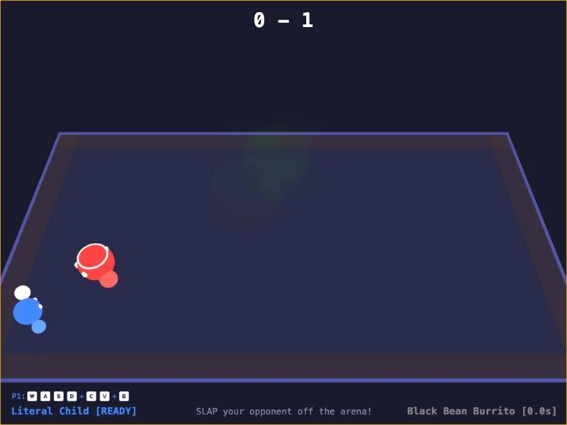

# Slap Master

A local multiplayer fighting game where you play as a floating head with big ol' hands, and win by slapping your opponent off the arena. It's inspired by Wii Sports Boxing and Circle of Sumo.

<p align="center"></p>

- **Two players on one computer, or you against the computer.** Share the keyboard, use gamepads, or pick **vs AI** at one of four difficulties.
- **Best of three rounds.** Slap with either hand, or both at once for a double slap, and knock the other head off the edge.
- **Three abilities.** Before each match, pick a dash that leaves a stink cloud, a small fast child, or an exploding melon.

## Getting started

Play it in your browser at [gridloc.dev/games/slap-master](https://gridloc.dev/games/slap-master), or run it from source:

```bash
pnpm install && pnpm dev   # serve on http://localhost:5173
```

See [Getting started](docs/getting-started.md) for requirements and other ways to run it.

## Learn more

- [How to play](docs/features.md) · [Controls](docs/controls.md) · [Credits](docs/credits.md)
- [All documentation](docs/README.md) · [Working on the code](docs/development.md)
