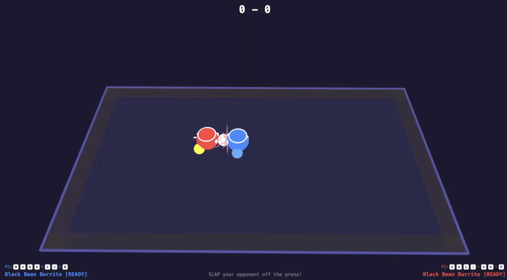

# Slap Master

<p align="center">
  
</p>

A local multiplayer fighting game where you play as floating heads with big ol' hands. Inspired by Wii Sports Boxing and Circle of Sumo.



---

## How to Play

### Objective

Knock your opponent off the stage with well-timed slaps. First to win 2 rounds wins the match.

### Controls

|                  | Player 1     | Player 2        |
|------------------|--------------|-----------------|
| Move forward     | `W`          | `O`             |
| Move backward    | `S`          | `L`             |
| Strafe left      | `A`          | `K`             |
| Strafe right     | `D`          | `;`             |
| Left slap        | `C`          | `Arrow Left`    |
| Right slap       | `V`          | `Arrow Right`   |
| Special ability  | `E`          | `P`             |

Gamepads are also supported.

### Combat

- **Slap** — Hit your opponent to send them flying. The closer you are, the stronger the hit.
- **Double slap** — Press both slap buttons at the same time for a powerful two-handed strike with massive knockback.
- **Clash** — If two slaps collide, both players bounce back.
- **Ring-out** — Knock your opponent off the edge to win the round.

### Abilities

Choose one ability at the start of each match:

**Burrito (Dash)**
Rocket yourself toward your opponent at high speed, leaving a stink cloud behind. Stink clouds slow down anyone who walks through them.

**Child (Speed)**
Shrink down, move faster, and take less knockback. Use quick taunts to stay unpredictable.

**Melon (Projectile)**
Throw a melon at your opponent. Double-slap near the melon to trigger an explosion that launches anyone caught in the blast.

---

## Building & Running Locally

**Prerequisites:** [Node.js](https://nodejs.org) (v18+) and [pnpm](https://pnpm.io).

```bash
# Install dependencies
pnpm install

# Start the development server (with hot reload)
pnpm dev

# Build for production
pnpm build

# Preview the production build
pnpm preview
```

Open your browser to the local URL printed by `pnpm dev` (usually `http://localhost:5173`).
